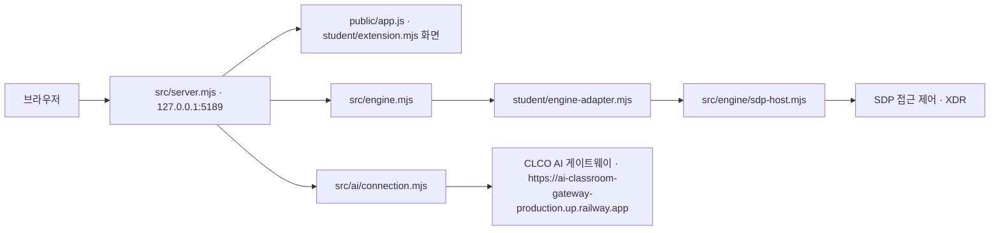

# 케셰브 실행 안내와 시스템 구성도 — 21단계

## 처음 보는 사람용 실행 안내 한 장 (마무리 5일차 · 2026-11-12 확인)

앱 이름은 **마르셀 갈랑**입니다(이 저장소의 `on-client` 앱). 표의 **[확인함]**은 이 PC에서 실제로 실행해 결과를 본 것입니다.

학원 워크벤치에서 만든 폴더 이름은 `마르셀갈랑-방어전`, `git clone` 으로 받으면 `defense-agent` 폴더가 생깁니다. 둘은 같은 저장소입니다.

| 순서 | 할 일 | 명령·주소 | 상태 | 비고 |
|---|---|---|---|---|
| 0 | 필요한 것 준비 | Windows(PowerShell 5.1), Node.js 22~24(권장 24.19.0), Git | [확인함] | 이 PC: Node.js `v24.22.x`, `git version 2.54.0.windows.1` |
| 1 | 받기 | `git clone https://github.com/LimByungKwan/defense-agent` 실행 뒤 `defense-agent\on-client` 폴더로 이동 | [확인함] | 2026-11-12 20:54 `C:\Users\quann\Documents` 에서 실행해 성공. 저장소가 비공개면 열람 권한이 필요합니다. |
| 2 | 켜기 | `on-client` 폴더의 PowerShell 에서 `powershell -NoProfile -ExecutionPolicy Bypass -File .\tools\start-alekov.ps1` | [확인함] | `케셰브가 켜졌습니다. 브라우저에서 http://127.0.0.1:5189/ 을 여세요.` 가 나오면 켜진 것입니다. |
| 3 | 브라우저로 열기 | `http://127.0.0.1:5189` | [확인함] | 다른 포트로 켰다면 주소의 숫자도 같게 바꿉니다. |
| 4 | 첫 화면에서 볼 것 | 보호 현황 → 「학생 상태·알림 표시」의 **① 내 PC 추이** → 「지금 측정」(한 번 잰 뒤에는 「다시 조회」) | [확인함] | CPU·메모리·디스크·Windows 방화벽·네트워크 구성·Windows 기록이 이 PC에서 잰 값으로 나옵니다. |
| 5 | 끄기 | 서버를 켠 PowerShell 창에서 `Ctrl+C` | [확인함] | 끈 뒤 브라우저를 새로고침하면 연결할 수 없다는 화면이 나옵니다. |
| 6 | 꾸밈을 바꿨을 때 | `student/appearance.json` 이나 그림을 바꾸면 `Ctrl+C` 로 끄고 2번으로 다시 켠 뒤 브라우저를 새로고침 | [확인함] | |

**"연결 없음"은 정상입니다.** 회사 서버(SDP)에 연결하지 않은 기본 실행이라 위쪽에 「연결 없음」, ② 회사 서버 연결 요약에 「○ SDP 미연결 (disconnected)」, 로그인·기기·세션에 「확인 불가」가 보입니다. 앱 고장이 아니며, ① 내 PC 추이는 회사 서버 연결 없이도 동작합니다.

### 막혔을 때 (실제로 막혔던 곳)

| 증상 | 원인 | 해결 | 상태 |
|---|---|---|---|
| `npm` 명령이 실행 정책 때문에 막힘 | PowerShell 실행 정책이 `npm.ps1` 실행을 막음 | `npm` 대신 `npm.cmd` 를 씁니다. 예: `npm.cmd run check` | [확인함] |
| PowerShell 에서 README 한글이 `??蹂댁븞` 처럼 깨짐 | Windows PowerShell 5.1 의 기본 읽기 인코딩 | `Get-Content README.md -Encoding UTF8` | [확인함] |
| 서버 창을 닫았더니 앱이 열리지 않음 | 그 PowerShell 창이 서버 자체라 창을 닫으면 앱도 꺼짐 | 쓰는 동안 창은 켜 둡니다. 다시 쓰려면 2번으로 켭니다. | [확인함] |
| `appearance.json` 을 바꿨는데 화면이 그대로 | 바꾼 꾸밈이 아직 반영되지 않음 | `Ctrl+C` 로 껐다가 2번으로 다시 켠 뒤 브라우저를 새로고침합니다. | [확인함] |

## 목적과 현재 지원 범위

케셰브는 이 저장소의 `on-client` 앱입니다. 제공 화면은 현재 사용자 범위의 로그인·기기·세션, 업무 앱 접근 판정, 보안 기록, PC 상태, 취약점 조회, 선택적 AI 기능을 표시합니다. 해당 기능이 구성되고 응답이 계약 검증을 통과해야 데이터가 표시됩니다. 기본 어댑터는 `evidenceMode: 'disconnected'`이며 `demo`는 예제 데이터입니다. 어느 상태도 실제 SDP·XDR 또는 AI 연결 성공을 자동으로 뜻하지 않습니다.

이 문서는 프로젝트 파일과 코드 계약을 읽어 작성했고, 2026-11-10 Windows의 `on-client`에서 새 PowerShell 창으로 실행해 확인한 결과도 구분해 기록합니다. 실제 확인은 아래 「실제 확인 결과」에 적은 로컬 서버 응답과 연결 없음 상태에 한정됩니다. 그 밖의 브라우저 동작·테스트·SDP/XDR·AI 게이트웨이 연결은 확인하지 않았습니다.

## 필요 프로그램·버전·설정 차이

| 항목 | 현재 파일에서 확인한 계약 | 직접 확인 상태 |
|---|---|---|
| Windows PowerShell | `.ps1` 실행 파일은 Windows PowerShell을 `C:\Windows\System32\WindowsPowerShell\v1.0\powershell.exe` 경로로 호출합니다. 실행 정책 우회는 시작 명령 한 번에만 적용됩니다. | Windows에서 새 PowerShell 창을 열어 시작 스크립트를 실행했습니다. `$PSVersionTable.PSVersion` 결과 `5.1.26100.9711`입니다. |
| Node.js | `package.json`은 `engines.node`를 `24.19.0`으로 지정합니다. 시작 스크립트는 major 22~24를 허용하고 `24.19.0` 설치를 권장합니다. | `node --version` 결과는 `v24.22.1`입니다. package 기준 `v24.19.0`과 다르지만 시작 스크립트의 허용 범위 22~24 안입니다. |
| npm / 의존성 | README는 외부 npm 의존성이 없다고 설명합니다. `package.json`에는 `start`, `demo`, `check`, `package-app` 스크립트만 있고 dependencies 항목은 없습니다. | npm 버전은 미확인입니다. 이전 단계에서 이 PC의 PowerShell 실행 정책 때문에 `npm` 실행이 막혔습니다. `npm.cmd`를 사용합니다(예: `npm.cmd run check`). `package-lock.json`은 프로젝트 파일 검색에서 발견되지 않았습니다. |
| 환경 변수 견본 | `.env.example`은 `on-client` 폴더에 있습니다. | `Test-Path` 결과 `True`입니다. 파일 내용과 값은 이 문서에 옮기지 않습니다. |
| SDP 설정 견본 | 코드에는 명시적 `-SdpHostConfig`/`--sdp-host-config` 인자가 있습니다. | SDP JSON 견본이나 학생용 설정 예제 파일은 확인되지 않았습니다. 설정은 담당자가 별도로 제공한 경우에만 사용합니다. |

`on-client`와 그 상위 폴더 모두 `.gitignore`가 없습니다. `.env`를 만들면 커밋에 포함될 수 있으므로 저장소 밖에 두고, 커밋 전에 `git status`로 확인합니다. 키·토큰·비밀번호·인증서·개인키를 문서·소스·커밋·제출물에 쓰지 마세요. `.env.example`의 존재만 확인했으며 내용·값은 옮기지 않습니다. SDP 설정 및 자격 자료는 담당자가 제공한 값만 사용하고 프로젝트 및 Git 저장소 밖에 둡니다.

## 폴더 구조와 PowerShell을 여는 위치

앱과 실행 스크립트는 저장소의 `on-client` 하위 폴더에 있습니다. **실행 명령은 `on-client`에서 실행**합니다. `<프로젝트 Git 최상위>`의 실제 폴더 이름은 `마르셀갈랑-방어전`입니다.

```text
<프로젝트 Git 최상위> (마르셀갈랑-방어전)/
└── on-client/
    ├── .env.example
    ├── package.json
    ├── tools/
    │   ├── start-alekov.ps1
    │   └── prepare-native-host.ps1
    ├── public/index.html
    ├── public/app.js
    ├── student/extension.mjs
    ├── student/engine-adapter.mjs
    ├── src/server.mjs
    ├── src/engine.mjs
    ├── src/engine/sdp-host-config.mjs
    ├── src/engine/sdp-host.mjs
    ├── src/ai/connection.mjs
    ├── src/actions/service.mjs
    ├── src/vulnerabilities/project-scan.mjs
    ├── src/pc-status.mjs
    └── docs/
        ├── STUDENT_LAUNCH_GUIDE.md
        ├── CONNECTION_TROUBLESHOOT.md
        └── STUDENT_RUNBOOK.md
```

파일 탐색기에서 실제 `on-client` 폴더를 열고 주소 표시줄에 `powershell`을 입력해 그 위치에서 새 PowerShell 창을 여세요. 기존 작업 폴더와 Git 변경 사항을 삭제하거나 덮어쓰지 마세요. 트리는 실행·문서에서 언급하는 주요 파일만 표시합니다. 트리의 파일은 2026-11-10 `Test-Path`로 존재를 확인했습니다.

## 실행·주소·종료와 재실행

### 시작 스크립트 옵션

`tools/start-alekov.ps1`의 옵션은 코드에서 읽었습니다. 이 표의 옵션 동작은 코드 확인이며, 각 옵션을 실제 실행해 검증한 것은 아닙니다.

| 옵션 | 값·기본값 | 뜻 |
|---|---|---|
| `-Port` | `1024~65535`, 기본 `5189` | 서버 포트 |
| `-Demo` | 스위치 | 예제 모드 |
| `-Background` | 스위치 | 뒤에서 실행 |
| `-NativeHostConfig` | 문자열 경로 | 계정 연결용 설정 파일 경로 |
| `-NoNativeHost` | 스위치 | 계정 연결용 로컬 준비를 사용하지 않음 |
| `-SdpHostConfig` | 문자열 경로 | SDP 설정 파일 경로 |
| `-WaitSeconds` | `1~120`, 기본 `20` | 서버 응답을 기다리는 시간 |

### 기본 실행

`on-client` 폴더에서 다음 명령을 입력합니다.

```powershell
powershell -NoProfile -ExecutionPolicy Bypass -File .\tools\start-alekov.ps1
```

실행 도구는 앱 폴더와 파일, Node 버전, 기본 포트 `5189`를 검사하고, 서버 프로세스를 시작해 기본 loopback 주소에서 HTTP 200 응답을 기다립니다. 기본 비-demo 실행에서는 `tools/prepare-native-host.ps1`을 호출해 사용자 프로필 아래에 계정 연결용 로컬 보관소 설정을 준비·재사용합니다. 이는 계정 로그인, 승인, AI 권한 또는 외부 연결이 완료됐다는 뜻이 아닙니다. 다른 앱을 종료하거나 Node.js를 설치하지 않고, 민감 정보 환경변수도 서버에 전달하지 않습니다.

포트 `5189`가 이미 사용 중이면 기존 프로그램을 종료하지 말고 다른 포트를 지정합니다.

```powershell
powershell -NoProfile -ExecutionPolicy Bypass -File .\tools\start-alekov.ps1 -Port 5190
```

포트를 바꿨다면 브라우저 주소도 같은 포트로 바꿉니다. `-Demo`는 실행 스크립트가 제공하는 예제 모드입니다.

```powershell
powershell -NoProfile -ExecutionPolicy Bypass -File .\tools\start-alekov.ps1 -Demo
```

예제 데이터는 실제 사용자·SDP/XDR 연결이나 성공 증거가 아닙니다. `package.json`의 `npm start`(`node src/server.mjs`)와 `npm run demo`(`node src/server.mjs --demo`)도 존재하지만 시작 스크립트의 사전 검사 절차를 거치지 않습니다. 처음 실행할 때는 위 PowerShell 시작 스크립트를 사용합니다.

### 선택적 SDP 설정

개인 SDP 설정을 담당자가 발급한 경우에만 시작 스크립트의 `-SdpHostConfig`를 사용할 수 있습니다. 코드는 Windows 절대 경로를 요구하고, 예제 설정 파일은 현재 확인되지 않았습니다. 따라서 실제 파일 경로를 확인하지 않고 실행할 명령을 만들어 두지 않습니다. 담당자가 준 실제 경로가 있을 때 명령 끝에 다음 인자를 추가하되 `<실제 SDP 설정 파일의 절대 경로>`는 반드시 본인 PC의 실제 경로로 대체하세요.

```text
-SdpHostConfig "<실제 SDP 설정 파일의 절대 경로>"
```

이 자리표시자를 그대로 실행하지 마세요. `-Demo`와 SDP 연결은 함께 사용할 수 없습니다. 설정 내용·자격 증명은 이 문서나 명령 기록에 넣지 않습니다. 시작 스크립트는 설정 경로를 검사하고 Node 서버에 `--sdp-host-config`로 전달합니다. 실제 SDP 접속 여부는 별도 상태입니다.

### 시작 신호와 브라우저 주소

기본 포트에서 시작 스크립트가 HTTP 200을 받으면 구현상 다음 안내가 나옵니다.

```text
케셰브가 켜졌습니다. 브라우저에서 http://127.0.0.1:5189/ 을 여세요.
서버가 응답한 것만 확인했습니다. AI 연결 상태는 화면에서 따로 확인해 주세요.
```

브라우저에서 `http://127.0.0.1:5189/`을 엽니다. 사용자 지정 포트는 해당 포트로 바꿉니다. 스크립트의 HTTP 200은 로컬 앱 서버의 응답만 확인합니다. 계정·AI 승인, SDP 접근 허가, XDR 기록 또는 업무 앱 접속 성공을 증명하지 않습니다.

### 종료와 재실행

- **기본 실행:** 스크립트가 `WaitForExit`로 PowerShell 창을 붙잡고 `끄려면 이 창에서 Ctrl+C 를 누르세요.`를 출력합니다. 이 기본 실행과 안내 문구는 직접 확인했습니다. `Ctrl+C` 뒤 브라우저를 새로고침해 로컬 앱이 더 이상 제공되지 않는지도 확인했습니다.
- **`-Background`:** `뒤에서 실행 중입니다(프로세스 번호 …). 끄려면 이 번호의 node 를 작업 관리자에서 종료하세요.`라고 출력합니다. 이 출력과 동작은 코드만 읽었으며 직접 실행해 확인하지 않았습니다.

재실행은 같은 `on-client` 폴더에서 기본 명령을 다시 입력합니다. 준비 도구는 같은 프로젝트의 프로필 설정을 재사용하도록 구성되어 있습니다.

## 시스템 구성도와 데이터 흐름

아래 ASCII 구성도는 흐름을 글로 설명합니다. 이어지는 Mermaid 구성도는 같은 구성을 도식화합니다.

```text
[브라우저]
    │ HTTP: http://127.0.0.1:5189/
    ▼
[on-client/src/server.mjs — loopback 로컬 앱 서버]
    ├── 화면: public/app.js · student/extension.mjs
    ├── 엔진 연결 경계: src/engine.mjs
    │       └── student/engine-adapter.mjs
    │              └── 명시 설정 시 src/engine/sdp-host.mjs
    │                    └── SDP 접근 제어 · XDR
    └── 별도 AI 경로: src/ai/connection.mjs
            └── CLCO AI 게이트웨이
                https://ai-classroom-gateway-production.up.railway.app
```



브라우저는 로컬 서버의 동일 출처 API를 사용합니다. 학생 코드에는 호스트가 정한 조회 API가 전달되며, 자격 파일과 SDP 연결 비밀은 서버 호스트에 남습니다. 기본 학생 어댑터는 `disconnected`입니다. SDP는 명시적 설정 경로에서만 연결을 만들고, AI 연결·점검은 별도의 사용자 동작과 권한 확인을 거칩니다. XDR은 별도 학생 권한/전체 운영자 조회를 뜻하지 않습니다. 외부 주소는 소스의 공개 상수에서 확인한 게이트웨이 주소입니다. 이 문서 갱신 중 어느 외부 연결도 호출하지 않았습니다.

## 함수·입력 계약·제공/학생 구현 경계

| 영역 / 파일·함수 | 입력과 코드상 역할 | 확인 상태·제한 |
|---|---|---|
| 제공 서버 `src/server.mjs` / `createOnServer()` | 브라우저 요청을 로컬 서버에서 처리합니다. 실행 인자는 코드에 정의된 값만 받으며 기본 포트는 `ON_PORT` 또는 `5189`, 바인딩은 `127.0.0.1`입니다. | 모드는 `connected`, `demo`, `disconnected`로 구분됩니다. 이번 직접 실행에서는 기본 포트의 서버 응답을 확인했습니다. |
| 학생 확장 `student/extension.mjs` / `createStudentView()` | 아래 표의 여덟 화면 함수를 제공합니다. 각 함수의 인자는 코드만 읽었습니다. | 아래 「학생 구현 함수별 화면 확인」에 실행 화면 확인과 미확인 범위를 나눠 적었습니다. |
| 학생 API 경계 `public/app.js` / `studentApi.get(path)` | 허용 GET 경로는 `/api/me`, `/api/apps`, `/api/events`, `/api/devices`, `/api/sessions`, `/api/vulnerabilities`, `/api/pc/status`입니다. 이 외 경로는 `NOT_ALLOWED`로 반환됩니다. | API 요청·응답을 실제 화면에서 확인한 범위는 「실제 확인 결과」에 적은 기본 실행뿐입니다. |
| 제공 학생 어댑터 `student/engine-adapter.mjs` / `createEngine(host)` | 필수 host 계약은 `projectId`, `readIdentity`, `readApps`, `decideAccess`입니다. 선택적으로 host의 `readEvents`, `readDevices`, `readSessions`만 전달합니다. | 기본 export는 `evidenceMode: 'disconnected'`입니다. 미지원 조회를 빈 성공으로 만들지 않습니다. |
| 엔진 `src/engine.mjs` / `loadEngine()`, `engineMethod()` | 서버 실행자가 지정한 어댑터 모듈만 로드합니다. 빠진 엔진 메서드는 `ENGINE_NOT_CONNECTED`를 냅니다. | 브라우저 요청으로 모듈 경로를 선택하지 않습니다. |
| SDP 설정 `src/engine/sdp-host-config.mjs` / `readSdpHostConfiguration()` | 명시한 설정 경로·프로젝트 경계·자격 자료를 검증합니다. 설정은 외부 경로에서 읽습니다. | 실제 설정 파일·자격·relay 연결은 확인하지 않았습니다. 비밀을 공개 문서에 적지 않습니다. |
| SDP 엔진 `src/engine/sdp-host.mjs` / `createSdpHostEngine()` | 고정 HTTPS 요청으로 context, 앱 및 접근 판정을 본인 scope에 결속해 검증합니다. 핵심 경로는 `/alekov/context`, `/alekov/apps`, `/alekov/decision`입니다. 앱 판정 입력은 `{appId, requestId}`와 scope입니다. | 결과 상태는 `allow`, `deny`, `challenge`이며 검증 불가와 연결 오류는 별도 오류입니다. 실제 endpoint 호출은 미확인입니다. |
| AI 연결 `src/ai/connection.mjs` / `createAlekovAppConnector()` | `begin({signal})`, `complete(handle, {signal, onStage})`로 승인 연결 흐름을 관리합니다. | 공개 게이트 주소와 함수 계약을 코드에서 읽었습니다. 사용자 승인·앱 권한·유료 AI 요청은 하지 않았습니다. |
| AI 설명 및 조치 서버 서비스 | 서버는 AI 응답의 evidence, proposals, 확인 필요 및 `executed: false`를 검증합니다. 조치 서비스는 범위·확인·결과를 별도 검증합니다. | AI 설명, 연결, 보안 조치 또는 실제 데이터 접근을 실행하지 않았습니다. |
| 취약점·PC 상태 `src/vulnerabilities/project-scan.mjs`, `src/pc-status.mjs` | 취약점 조회는 설정된 프로젝트 및 잠금 파일을 사용하고, PC 상태는 로컬 상태를 읽는 경로입니다. | `package-lock.json`은 검색에서 발견되지 않았습니다. OSV 조회, 실제 PC 상태 및 방화벽 결과는 미확인입니다. |

### 학생 구현 함수별 화면 확인

| 함수 | 단계 | 받는 값 | 실제 화면 확인 | 코드만 읽음 |
|---|---:|---|---|---|
| `renderIdentity` | 13 | `me`, `devices`, `sessions` (`student/extension.mjs: 31`) | 오늘 기본 실행: `연결 모드: 연결 없음 (disconnected)` | 함수 입력과 상태 렌더링 분기 |
| `renderDecision` | 14 | `status`, `mode`, `data`, `error`, `appId` (`student/extension.mjs: 130`) | 이 함수의 화면 출력은 이번 직접 확인 결과에 포함되지 않음 | 함수 입력과 판정 상태 렌더링 분기 |
| `renderEvents` | 15 | `status`, `mode`, `data`, `error` (`student/extension.mjs: 180`) | 이전 단계 Demo: 보안 기록 `event-01` 1건 | 함수 입력과 기록 렌더링 분기 |
| `renderStatus` | 16 | `devices`, `sessions`, `notifications`, `diagnostics`, `mode` (`student/extension.mjs: 356`) | 오늘 기본 실행: `등록 기기 조회 실패 (ENGINE_NOT_CONNECTED)` 및 「다시 불러오기」 안내 | 함수 입력과 상태·재시도 안내 렌더링 분기 |
| `renderAiConnection` | 17 | `status`, `mode`, `data`, `error`, `checkedAt`, `explanationAccepted` (`student/extension.mjs: 661`) | 오늘 기본 실행: `AI 연결 점검 전 (idle)`. 이전 단계 Demo에서 「AI 연결 점검」 요청은 `ON_AI_PROVISIONING_PENDING` | 함수 입력과 AI 점검 상태 렌더링 분기 |
| `renderExplanation` | 17·18 | `event`, `explanation`, `checkedAt` (`student/extension.mjs: 714`) | 이전 단계 Demo에서 「AI 설명 요청」은 `ON_AI_PROVISIONING_PENDING` | 함수 입력과 AI 설명 렌더링 분기 |
| `renderAction` | 19 | `status`, `event`, `actionId`, `target`, `receipt`, `observation`, `message`, `confirmationExpiresAt`, `error` (`student/extension.mjs: 853`) | 이전 단계 Demo는 `supportedActions []`라 `idle`만 | 조치 진행·결과는 화면으로 확인하지 않음. 함수 입력과 상태 렌더링 분기 |
| `renderVulnerabilities` | 20 | `status`, `mode`, `data`, `error` (`student/extension.mjs: 533`) | 오늘 기본 실행: `조회 전 (idle)`. 이전 단계 Demo 패키지 조회: `not_configured` / `PROJECT_NOT_CONFIGURED` / `packages []` | 패키지 행·취약점 표시는 화면으로 확인하지 않음. 함수 입력과 조회 상태 렌더링 분기 |

AI 설명 성공, 조치 진행·결과, 패키지 행·취약점 표시, 취소 타이밍은 화면으로 확인하지 않았습니다. 정확한 API 상태값·오류 코드는 응답 계약대로 취급합니다. 예를 들어 `ENGINE_NOT_CONNECTED`, `ENGINE_TIMEOUT`, `ENGINE_RESULT_UNVERIFIED`, `SUBJECT_SCOPE_UNVERIFIED`, `REQUEST_CANCELLED`는 서로 다른 오류이며, `unknown`이나 미확인을 허용·거부·빈 결과로 바꾸지 않습니다.

## 실제 확인 결과

**확인 일시·환경:** 2026-11-10, Windows, `on-client`에서 새 PowerShell 창.

`node --version` 결과는 `v24.22.1`이었습니다. `package.json`의 `engines` 기준 `24.19.0`과 다르며, 시작 스크립트의 허용 범위 `22~24` 안입니다.

기본 실행에서 다음 출력을 직접 확인했습니다.

```text
계정 연결 준비가 끝났습니다. 앱에서 확인 번호로 로그인·승인을 진행하세요.
참고: 지금 Node.js 는 v24.22.1 입니다. 수업 기준은 v24.19.0 입니다.
케셰브 연결 확인: http://127.0.0.1:5189
케셰브가 켜졌습니다. 브라우저에서 http://127.0.0.1:5189/ 을 여세요.
서버가 응답한 것만 확인했습니다. AI 연결 상태는 화면에서 따로 확인해 주세요.
끄려면 이 창에서 Ctrl+C 를 누르세요.
```

`계정 연결 준비가 끝났습니다`는 준비 완료일 뿐, 로그인·승인·AI 권한 완료를 뜻하지 않습니다. 브라우저 `http://127.0.0.1:5189` 상단에서 `연결 없음`을 확인했고, 로그인 정보 `me`·업무 앱 `apps`·보안 기록 `events`·기기 `devices`·세션 `sessions` 모두 `ENGINE_NOT_CONNECTED`였습니다. `Ctrl+C` 뒤 새로고침에서 `ERR_CONNECTION_REFUSED`가 나와 서버 종료를 확인했습니다. 실행 전후 `git status`에서는 새 파일이 없었습니다.

이 결과는 로컬 서버 응답과 연결 없음 상태만 확인한 것이며 SDP·XDR·AI 연결 성공을 확인한 것이 아닙니다.

## 장애별 확인 순서와 복구

| 상황 | 확인 순서 | 안전한 복구 판단 |
|---|---|---|
| 잘못된 폴더 또는 시작 파일 누락 | PowerShell이 `on-client`에 있는지, `tools/start-alekov.ps1`, `src/server.mjs`, `package.json`이 있는지 확인합니다. | 실제 앱 폴더에서 다시 실행합니다. 학생 파일을 새로 만들거나 교체하지 않습니다. |
| Node 버전 오류 | `node --version`으로 현재 버전을 직접 확인합니다. | 코드 기준 `24.19.0`을 확인합니다. 시작 스크립트는 22~24를 허용하지만 이는 package의 고정 버전과 동일한 계약이 아닙니다. 도구가 Node를 설치하지 않습니다. |
| PowerShell에서 `npm` 실행 차단 | 이 PC의 이전 단계에서 PowerShell 실행 정책 때문에 `npm`이 막혔습니다. | `npm.cmd`로 실행합니다(예: `npm.cmd run check`). 2026-11-10 `npm.cmd run check` 실행 결과 오류 없이 끝났습니다. |
| 포트 충돌 | 실행 스크립트의 포트 오류를 확인합니다. 다른 앱을 종료하지 않습니다. | `-Port 5190`으로 바꾸고 브라우저 주소도 같은 포트로 엽니다. |
| 서버 응답 대기 시간 초과 | 폴더, Node 버전, 지정 포트, PowerShell의 서버 오류 순서로 확인합니다. | 같은 프로젝트에서 원인을 해결한 뒤 재실행합니다. 서버 미응답을 SDP·AI 오류로 단정하지 않습니다. |
| 화면의 연결/기록 오류 | 화면의 상태와 오류 코드를 읽습니다. `ENGINE_NOT_CONNECTED`는 연결 없음, `ENGINE_TIMEOUT`은 시간 초과, `ENGINE_RESULT_UNVERIFIED`는 응답 검증 실패, `SUBJECT_SCOPE_UNVERIFIED`는 범위 확인 실패입니다. | 기본 학생 어댑터(`disconnected`)로 실행한 2026-11-10 기본 실행에서 `ENGINE_NOT_CONNECTED`를 확인했습니다. SDP 설정은 `docs/STUDENT_LAUNCH_GUIDE.md` 안내대로 담당자가 개인 설정 파일을 안내한 경우에만 사용합니다. 확인 불가를 빈 목록 또는 접근 허용으로 처리하지 않습니다. |
| AI 칸 `ON_AI_PROVISIONING_PENDING` | 이전 단계 Demo에서 확인한 상태입니다. | 앱 권한 준비 중입니다. 자동 재시도나 유료 요청을 하지 않습니다. |
| AI 연결/설명 오류 | AI 오류 코드 및 현재 계정·앱 권한 상태를 SDP 오류와 분리해 확인합니다. | 서버 기동이나 AI transport 점검을 AI 권한·사건 설명·단계 통과로 기록하지 않습니다. 자동 재시도나 임의의 유료 요청을 하지 않습니다. |
| 취약점 조회 미확인 | 대상 프로젝트 폴더와 `package-lock.json` 존재 여부를 확인합니다. | 조회 전·미조회·불완전 결과를 “취약점 없음”으로 표현하지 않습니다. |

상세 오류 안내는 기존 `docs/CONNECTION_TROUBLESHOOT.md`와 설정을 발급한 담당자의 안내를 확인합니다. 이 문서에 없는 복구 명령이나 설정 형식을 추측하지 않습니다.

## 21·22단계 제출 안내

학생 문서와 이번 단계 코드는 같은 커밋에 저장합니다. 이미 커밋 준비 중인 변경이 있으면 내용을 먼저 확인해 기존 작업을 보존합니다. 21·22단계는 과제 화면에 저장소 주소와 제출할 40자리 커밋을 직접 입력합니다. 현재 워크벤치의 “포털 제출 준비”가 이 단계를 지원한다고 가정하지 않습니다.

비공개 저장소 원문 제출은 같은 단계 화면에서 “비공개 저장소 원문 준비 방법”을 펼치고 “원문 전달 도구 받기”를 누른 뒤 그 화면의 `student-source-cli.mjs` 명령을 따릅니다. 실제 PC 경로와 커밋을 확인하지 않았으므로 이 문서에 실행 명령을 임의로 만들지 않았습니다. ZIP은 프로젝트 밖에 풀고 JSON 출력용 새 폴더도 프로젝트 밖에 만듭니다. 제출 저장소 최상위의 PowerShell에서 본인 PC 경로와 커밋을 반영해 실행합니다. 이 도구는 커밋된 원문만 묶으며 학생 코드를 실행하거나 업로드하지 않습니다.

JSON을 같은 단계의 “비공개 저장소 원문 묶음”에서 선택하고 저장소·커밋·단계를 다시 확인합니다. 원문 전달 완료는 AI 검토 통과가 아니므로 서버 상태와 판정 설명을 확인합니다. 원문 전달만 실패한 경우 기존 접수를 보존하고 “원문만 다시 보내기”를 사용합니다. 제공 서버는 문서의 실행 명령을 실행하지 않습니다.

기존 `docs/STUDENT_LAUNCH_GUIDE.md`는 보존했습니다. 기존 문서의 13~20단계 제출 설명과 현재 공식 안내의 21·22단계 제출 방식은 다릅니다. 21·22단계는 위에 적은 현재 과제 화면 절차를 따르세요.

## 문서와 현재 코드 대조 메모

- `.env.example`은 `on-client`에 있으며 `Test-Path` 결과가 `True`입니다. 파일 내용과 값은 문서에 옮기지 않았습니다. `on-client`와 상위 폴더에 `.gitignore`가 없어 `.env`는 저장소 밖에 두고 커밋 전 `git status`로 확인하도록 적었습니다. `.gitignore`는 만들지 않았습니다.
- `package.json`은 Node.js `24.19.0`을 지정하지만 시작 스크립트는 Node.js 22~24를 허용합니다. 직접 확인한 `v24.22.1`은 허용 범위 안이지만 package 기준과는 다릅니다.
- 기존 `docs/STUDENT_LAUNCH_GUIDE.md`는 13~20단계 일반 제출 절차를 포함하고, 이번 과제 안내의 21·22단계 직접 입력·비공개 원문 절차와 다릅니다. 기존 안내를 덮어쓰지 않고 단계별 차이를 표시했습니다.
- 직접 확인한 것은 로컬 서버 응답, 기본 화면의 연결 없음·`ENGINE_NOT_CONNECTED`, 종료 및 `git status`의 새 파일 없음입니다. SDP·XDR·AI 연결과 성공은 확인하지 않았습니다.
- 이번 문서 갱신에서 편집 대상은 `on-client/docs/STUDENT_RUNBOOK.md` 하나입니다. 다른 README, 학생 코드, 제공 서버, `public/app.js`, 판정 코드, 인증 설정, Git 기록은 수정하지 않았습니다.

## 사용자가 직접 확인할 순서

1. 기존 작업을 보존한 채 `on-client`에서 새 PowerShell 창을 열고, 위 **기본 실행** 명령을 따라 실행합니다. 화면이나 PowerShell 결과를 직접 확인하기 전까지는 코드에서 예상한 출력과 실제 결과를 구분합니다.
2. 실행 뒤 실제 `package.json`, 폴더 위치, 스크립트 옵션, 안내 주소, 브라우저 주소를 이 문서와 대조합니다. 불일치하거나 확인하지 못한 항목은 미확인으로 둡니다.

기본 실행·기본 브라우저 연결 없음·종료 결과는 위 「실제 확인 결과」에 적었습니다. 그 밖의 확인을 했다고 주장하지 않습니다.

## 확인 상태와 미확인 범위

| 확인 방식 | 결과 |
|---|---|
| 코드 읽기 | README, `package.json`, 시작 스크립트, 제공/학생 어댑터, 학생 렌더러, 서버·엔진·SDP·AI·스캐너·PC 상태 및 관련 기존 문서를 읽었습니다. |
| 로컬 실행·화면 | 2026-11-10 Windows의 `on-client` 새 PowerShell 창에서 `node --version`, 기본 시작, 기본 브라우저 연결 없음, `Ctrl+C` 후 `ERR_CONNECTION_REFUSED`를 확인했습니다. |
| 자동 검사 | `npm.cmd run check`: 문법 검사 통과(오류 출력 없음). `node --check`는 문법만 검사하며 동작 검증이 아님. `npm start`, `npm run demo`, 테스트, 키보드 조작은 미확인입니다. |
| 연결·보안 서비스 | 실제 SDP, XDR, AI 게이트웨이, 계정 승인, OSV, 로컬 방화벽 및 조치 결과는 미확인입니다. 로컬 서버 응답은 이 연결들의 성공을 뜻하지 않습니다. |
| 현재 PC | Node.js `v24.22.1`과 기본 실행에서 `5189`의 서버 응답만 직접 확인했습니다. npm 버전은 미확인입니다. `$PSVersionTable.PSVersion` 결과 `5.1.26100.9711`입니다. 실제 프로젝트 전체 경로, 다른 포트 상태는 미확인입니다. |
| 제출 | 실제 제출 화면·원문 전달·AI 검토·저장소 주소·커밋 해시는 미확인입니다. |
| Git 상태 | 실행 전후 `git status`에서 새 파일이 없음을 확인했습니다. |

---

문서 상태: 코드 대조 문서 갱신 완료 · 로컬 서버 응답과 연결 없음 상태 확인 · SDP/XDR/AI 서비스 연결 미검증
